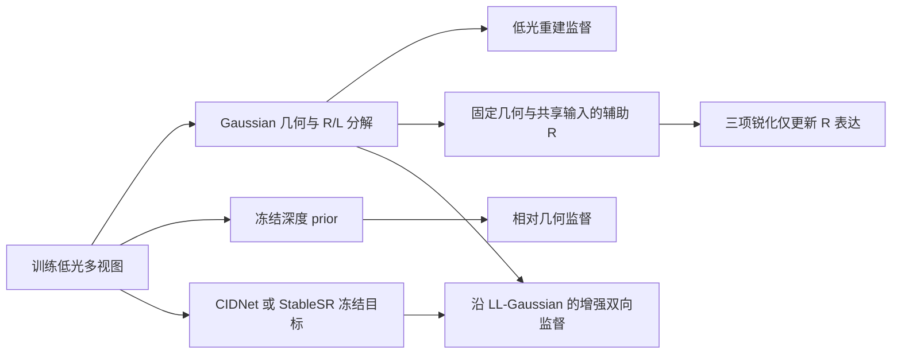

# ASG 反射率／光照分解与训练监督

本文对应 `asgplus2` 的训练权限与 prior 兼容修正。核心结构沿用 anchor/offset Gaussian 表示、显式反射率、方向性光照、增强光照及可选训练 residual。三项反射率锐化约束通过固定几何的辅助光栅化更新反射率表达，真实低光重建继续联合优化几何和外观。



## 一、模型表示与可解释参数

### 反射率 R

每个 anchor 的对数底色为 $B_a$，每个 offset 的细节参数为 $d_{a,k}$。显式反射率为

$$
R_{a,k}=\operatorname{clip}_{[\epsilon_R,1]}
\left[\exp\{B_a+\rho\tanh(d_{a,k})\}
\left(1+\eta\tanh D_\theta(f_a,o_{a,k})\right)\right].
$$

$\rho$ 控制细节在 log-reflectance 空间的表达半径；裁剪前，细节对应相对底色的乘性范围 $[e^{-\rho},e^\rho]$。$\eta$ 限制 decoder 的相对修正幅度，其乘性因子落在 $[1-\eta,1+\eta]$；约束 $0\leq\eta<1$ 保证乘性修正为正。$\epsilon_R$ 是对数运算和反射率输出的数值下限。这些量属于表达容量与数值约束，不是经过标定的材质常数。

默认关闭 view feature bank，此时 explicit R 的输入只有 anchor 特征与局部 offset，不直接接收视角方向或光照。开启历史 feature-bank 选项时，经过视角加权的共享特征会使 R 间接依赖视角；本次保留该选项原有前向，不把它描述成严格的视角无关表示。MLP-R 兼容路径保留，启用距离输入时也不具有严格的视角无关性。

初始化仅使用训练相机序列的第一帧：

$$
Q=\operatorname{clip}_{[\epsilon_R,1]}
\frac{I}{\max(\max_c I_c,\epsilon_I)},\qquad
B_a=\log\operatorname{clip}_{[\epsilon_R,1]}
\{Q+\alpha[Q-\operatorname{AvgPool}_{w}(Q)]\}(\pi_a).
$$

$\epsilon_I$ 限制暗信号归一化的放大，$\alpha$ 控制局部细节注入，$w$ 是像素空间观察窗口。投影与 CUDA 光栅化使用同一矩阵布局和像素纵轴约定。视锥外、相机后方、非有限及无信号投影使用有效区域的平均 log-reflectance 回填；没有有效信号时使用零 B0。该初始化未做遮挡可见性判定，后续多视角重建负责修正冲突。已保存模型直接恢复 B0，不重新初始化。

### ASG／SG 光照 L

默认低光光照采用具有正交切向坐标的 ASG：

$$
L_{a,k}(v)=\operatorname{clip}_{[0,1]}
\left[b_{a,k}+h(r_a)\frac{1}{M}\sum_m a_{a,k,m}
\max(\mu_m^\top v,0)
\exp\{-\lambda_{x,m}(t_{x,m}^\top v)^2-\lambda_{y,m}(t_{y,m}^\top v)^2\}\right].
$$

$\mu$ 给出响应主轴，$t_x,t_y$ 给出切向轴；两轴锐度 $\lambda_x,\lambda_y$ 控制角带宽，$a$ 表示响应幅度，$b$ 表示方向无关的基础照明。锐度通过正值变换与下限保证合法，方向经过归一化。$M$ 控制方向响应容量。默认 $h(r)=1$；开启距离项时，代码使用正值参数控制的对数距离衰减。

标准 SG 仍可通过 `--illumination_mode sg` 选择，其响应为叶瓣 $a_m\exp[\lambda_m(\mu_m^\top v-1)]$ 的均值。增强光照沿用现有 SG 调制与上下文门控，基础光照上下文及共享特征进入增强分支前停止梯度。

R/L 从普通 sRGB 图像中共同学习，存在尺度、颜色归属等不可辨识性。这里的光照是有效的视角相关响应，没有显式求解真实入射光与 BRDF；R 也不是经过标定的 albedo。现有 `asg_energy`／`sg_energy` 表示叶瓣幅度代理统计，不是球面积分辐射能量。

## 二、渲染与监督权限

令 $\mathcal S_G$ 表示给定几何、透明度和相机的 alpha 光栅化。保留当前训练及正式渲染的图像空间分量合成：

$$
\hat I_{\rm low}=\operatorname{clip}\left[\mathcal S_G(R)\odot\mathcal S_G(L)+T\right],
\qquad
\hat I_{\rm enhanced}=\operatorname{clip}\left[\mathcal S_G(R)\odot\mathcal S_G(L^+)\right].
$$

$T$ 沿用现有可选 residual／dual-transient 调度及掩码；默认最终输出不包含该训练补偿。`render` 字段仍保留原有点级联合光栅化结果，正式训练和导出通过 `compose_decomposed_render` 使用分量乘积。`render_fast` 同样分别光栅化 R 与增强 L 后相乘；因此它现在需要两次分量光栅化，其速度不能沿用旧单次联合光栅化的测量结果。

### 固定几何的 R 锐化

补边、局部对比度及高频约束使用同一形式的单边结构补足：

$$
\mathcal L_{R,j}=\operatorname{mean}
\left[m_j(I)\,\max\{\tau_j A_j(I)-A_j(R_{\rm aux}),0\}\right],
$$

其中 $A_j$ 分别对应归一化梯度、局部标准差与 Laplacian 幅值，$m_j$ 是从低光输入构造并停止梯度的结构权重。$\tau_j$ 表示最低期望结构响应比例，阈值控制哪些结构参与约束，局部窗口定义像素空间支持范围。

辅助图满足

$$
R_{\rm aux}=\mathcal S_{\operatorname{sg}(G)}
\left(R(B,d,\theta;\operatorname{sg}(f),\operatorname{sg}(o))\right),
$$

其中 `sg` 表示停止梯度。辅助计算冻结中心、offset、屏幕坐标、透明度、尺度、旋转、相机变换，以及 R 预测所使用的共享特征和可选距离。它与普通 R 图前向相同，改变的是优化权限。辅助屏幕梯度不进入增密统计，主重建仍保留正常梯度。

| 监督项 | 梯度权限 |
|---|---|
| 真实低光 L1／SSIM 重建 | 保留原主几何、R/L、共享特征和可选 residual 的梯度 |
| R 补边、局部对比度、高频三项 | explicit：仅 B0/detail/decoder；MLP：仅 MLP-R |
| 其他 R 图像正则、L 平滑、SG／ASG 正则 | 保留当前主路径行为，本次未扩大隔离范围 |
| 增强 prior 的增强 L 项 | 固定图像 R；增强光照光栅化只停止三维中心的直接位置梯度，其余仍沿 LL-Gaussian 路径传播 |
| 增强 prior 的 R 项 | 固定图像增强 L，保留普通 R 图的梯度路径与当前实验权重 |
| 深度 prior | 通过深度值及 alpha 混合权重约束几何；prior 自身停止梯度 |

增强 prior 的两项监督仍为

$$
\mathcal L_{\rm prior}=
\|\mathcal S_G(L^+)\odot\operatorname{sg}(\mathcal S_G(R))-P\|_1
+\lambda_{P,R}\|\operatorname{sg}(\mathcal S_G(L^+))\odot\mathcal S_G(R)-P\|_1.
$$

这里没有将整个增强 prior 改为“只更新增强光照”。原版仅停止部分位置路径，透明度、尺度、旋转及其上游共享参数仍可能收到增强监督梯度；这与三项 R 锐化的完整几何隔离不同。

## 三、2D prior 与 depth prior

### 可替换的冻结 2D prior

`--enhancement_prior cidnet|stablesr` 选择目标提供者，默认仍为 CIDNet。CIDNet 保留独立 conda 环境、控制器优化、轮次缓存和刷新策略；StableSR 使用增益后的训练低光图生成静态目标。增益沿用训练集平均亮度与目标亮度的原有整数比例策略。

两者交给训练的目标均为停止梯度、有限、范围合法且与相机分辨率对齐的 RGB 图。StableSR 只在缺失缓存时加载，兼容旧 UID 文件名及图像名，完整缓存直接复用，部分缓存只补缺失视角。生成后从保存的 PNG 统一读回，保证新生成和缓存命中的目标一致。缺失或损坏的缓存会明确报错。旧缓存沿用原文件命名约定，不额外保证其输入／权重来源；更换数据划分、相机编号、权重或配置后，应使用相应的新实验缓存。

正常光 GT 仅用于最终图像评估，不参与 2D prior、depth prior 或 B0 初始化。最终渲染只需训练得到的表示和网络，不加载 StableSR、CIDNet 或深度网络。

### 相对深度监督与正确梯度

深度网络冻结权重，只处理训练低光输入，按相机分辨率对齐后构造相对深度目标。保留 LL-Gaussian 的累积深度：

$$
D(p)=\sum_i\alpha_i(p)\,\mathcal T_i(p)\,z_i,
\qquad
\tilde D(p)=1-\operatorname{minmax}_{\Omega}(D)(p).
$$

$z_i$ 是相机空间深度，$\mathcal T_i$ 是该 Gaussian 前面的透射率。$\Omega$ 只包含有限且有覆盖的有效像素。损失在采样局部窗口上比较 $\tilde D$ 和深度 prior 的 Pearson 相关性。该值是累积深度的相对代理，没有除以覆盖率，因此仍受到覆盖率影响；它不是度量深度，也不是严格的逆深度。

小图使用裁剪后的窗口，窗口起点包含合法边界，采样至少产生一个候选窗口。无覆盖、非有限及不足以计算相关性的观测被忽略；常量或无有效信号的窗口返回可微零损失。相关性保留负相关区间，使错误的相对方向仍能得到纠正梯度。

原 CUDA depth 输出的 backward 缺少 $\partial D/\partial z_i$ 的直接项。训练用零背景辅助 RGB 光栅化编码 $(z_i,1,0)$，分别取得同定义的累积深度与覆盖率。深度梯度通过颜色通道回传 $z_i$，同时保留 alpha 混合权重梯度；覆盖率仅用于停止梯度的有效性判定。原 `render_depth` 导出字段保持不变，训练改用 `render_depth_for_loss`。深度的屏幕梯度继续参与既有几何训练统计。

## 四、训练、恢复与运行

1. 从点云和训练相机初始化 Gaussian／B0，生成并释放冻结的深度模型。
2. warmup 按原阶段设置稳定几何和分解；三项 R 锐化始终使用辅助 R 图，不准备增强 prior。
3. 主阶段按选定提供者准备增强目标，执行现有联合优化、增密裁剪和可选 residual 策略；保留所有现有阶段数值和场景特例。
4. 新训练 checkpoint 在原张量元组后附带版本状态，额外保存网络权重、反射率表示参数、位姿、统计和 prior 轮次。旧元组仍可恢复其原本包含的状态，但旧格式未保存的网络权重无法凭空恢复。
5. PLY／split 网络通过相邻 `representation_config.json` 保存表示参数，unite 网络中也保存参数副本。旧产物没有元信息时回填历史数值。推理使用 `eval()` 与无梯度路径，位姿优化阶段保留所需梯度。

```bash
# 直接训练：除 prior 提供者外，训练参数按已有实验配置传入。
python train.py --eval --use_wandb -s /path/to/scene -m /path/to/output --illumination_mode asg --enhancement_prior cidnet
python train.py --eval --use_wandb -s /path/to/scene -m /path/to/output --illumination_mode asg --enhancement_prior stablesr --stablesr_config ./configs/config.gin

# 现有五场景入口继续保留各场景数值，缺省为 CIDNet。
bash scripts/run_five_scene_asg_nor_8k.sh --scene chair --enhancement-prior stablesr

# 正式导出无需加载 prior；固定测试位姿时使用 skip_optimize。
python render.py -m /path/to/output --dataset_path /path/to/scene --skip_train --skip_optimize
```

通用 `scripts/train.sh` 在原有完整实验调用后追加 `--enhancement-prior stablesr` 即可切换；其余历史必需参数仍按原实验提供。

## 五、实验配置数值与证据边界

以下默认值来自修复前代码，仅将其命名并保存，不表示本轮重新调参。历史脚本显式提供的配置和场景特例仍优先用于对应实验。

| 配置 | 默认值 | 含义 |
|---|---:|---|
| `reflectance_detail_scale` | 1.1 | log-detail 表达半径 $\rho$ |
| `reflectance_decoder_scale` | 0.15 | decoder 相对修正上界 $\eta$ |
| `reflectance_floor` | 0.001 | 反射率数值下限 $\epsilon_R$ |
| `b0_init_intensity_floor` | 0.1 | 暗信号归一化下限 $\epsilon_I$ |
| `b0_init_detail_gain` | 0.4 | 初始化细节增益 $\alpha$ |
| `b0_init_window_size` | 5 | 初始化局部窗口，单位：像素 |
| `reflectance_edge_uplift_threshold` / `target_ratio` | 0.15 / 0.85 | 补边参与阈值／目标比例 |
| `reflectance_contrast_threshold` / `target_ratio` | 0.1 / 0.8 | 局部对比参与阈值／目标比例 |
| `reflectance_contrast_window_size` | 5 | 局部对比窗口，单位：像素 |
| `reflectance_highfreq_threshold` / `target_ratio` | 0.1 / 0.85 | 高频参与阈值／目标比例 |
| `depth_loss_weight` | 0.15 | 相对几何监督权重 |
| `depth_patch_size` / `depth_sample_fraction` | 128 / 0.5 | 局部深度支持窗口／采样预算 |
| `depth_prior_encoder` | vitl | 冻结的 Depth Anything V2 模型规格 |
| `enhancement_target_mean` | 0.45 | 原整数增益策略的目标亮度 |

全部新增参数进入 `cfg_args` 和旧配置回填。其余学习率、损失权重、SG／ASG 叶瓣数和初始化、阶段日程、残差与 CIDNet 参数继续使用原 CLI／脚本配置。正则权重代表相应约束相对于重建项的优化强度；其取值属于实验设置，不应被解释为物理常数。

回归检查覆盖三项锐化各自的梯度权限、主重建控制组、prior 缓存与尺寸、深度退化窗口和有限差分、配置及 checkpoint 恢复。真实 CUDA 检查额外覆盖完整 renderer、PLY／split／unite 恢复和普通／fast 渲染一致性；CPU 机器会明确跳过这些检查。实现正确性检查不能替代多场景训练、消融与视觉评估，本次不提出性能优于基线或泛化已经改善的结论。

### 方法自检与主张对应

| 维度 | 检查结论 |
|---|---|
| 贡献 | 主张限定为训练梯度权限和 prior 工程兼容修正，不宣称新的完整物理成像模型 |
| 表述 | 明确普通 R、辅助 R、低光 L、增强 L 和相对深度代理的区别 |
| 实验强度 | 梯度与恢复测试用于验证实现；无新的完整训练证据 |
| 评估完整性 | CUDA 专属检查单列；不将条件跳过当成通过，不混用不同合成协议的速度和质量结果 |
| 方法合理性 | 保留 sRGB 分解不唯一、低光结构含噪和累积深度受覆盖率影响等限制 |

| 主张 | 对应证据 | 状态 |
|---|---|---|
| 三项 R 锐化不再更新几何／共享特征 | CPU 真实模型方法及 autograd 边界测试；完整 CUDA renderer 权限测试 | CPU 可验证，真实 CUDA 需对应运行环境 |
| 新旧 prior 命名可加载、部分缓存只补缺失项 | 缓存、冻结 backend、尺寸及磁盘读回一致性测试 | 可在 CPU 验证；真实网络推理需权重与运行环境 |
| 深度辅助路径具有直接深度梯度 | CPU 有限差分及真实 CUDA 累积深度／有限差分测试 | CPU 可验证，真实 CUDA 需对应运行环境 |
| 新状态可保存／恢复网络及表示参数 | CPU checkpoint／配置回归，真实 CUDA PLY／split／unite 测试 | 按运行环境分别记录 |
| 提升重建指标或跨场景泛化 | 本轮没有完整训练和多场景对照 | 未建立，不作此主张 |

### 本次本机验证记录（2026-10-22）

`python -m unittest discover -s tests -v` 共发现 30 项：27 项通过，3 项真实 CUDA 集成检查因环境不具备相应扩展而跳过。`compileall`、两个修改脚本的 `bash -n` 及 `git diff --check` 均通过。CPU 测试执行源文件中的真实模型／Gaussian 生成方法，并使用轻量场景、替代光栅器及后端测试替身；没有执行真实 StableSR/CIDNet 权重推理、完整 CUDA 训练或图像指标评估。
