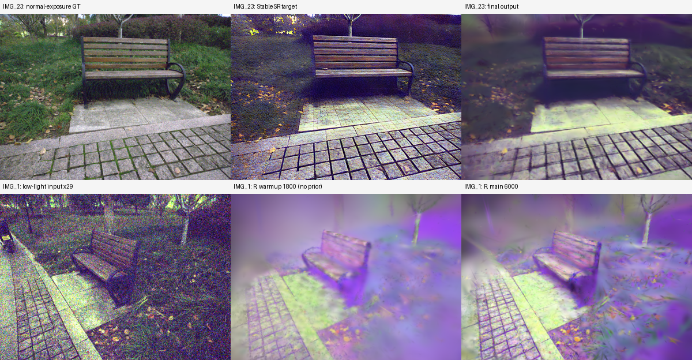

# chair 伪影诊断（2026-10-22）

对应 W&B run `t1v0cxo7`，实验目录 `experiments/llrs2_chair_asg_stablesr_6k_20261022_132235`。网页抓取不可访问，实际证据来自远程同 run ID 的 W&B 媒体和 summary、实验配置及代码备份，并对 iteration_6000 做了两个视角的只读推理。不改训练代码、参数、缓存或 checkpoint，不进行再训练。

## 结论与置信度

偏色与块状模糊是两个相互影响的问题。现有证据首先指向低光颜色/噪声进入 R 与 StableSR 目标，以及训练中高斯的大范围混合；不支持把问题简单归结为 LLRS2 格式、residual 或初始点云数量。以下是诊断证据，不是已完成的因果消融。

1. **已确认：伪影在训练视角也存在。** 用户截图的场景构图对应监控中的训练视角 IMG_23；它的最终输出、StableSR 目标和 R 图都存在紫色偏色。不是仅测试视角泛化不佳。
2. **已确认：StableSR 不是偏色的唯一来源。** 固定测试视角 IMG_1 在 warmup 1800 的 R 已偏紫，当时没有准备/使用增强 prior。6000 步仍有同类偏色。训练阶段 R 使用低光颜色，基础 illumination 为单通道，正常曝光图没有提供颜色监督。
3. **已确认：StableSR 目标有明显颜色偏差。** IMG_23 正常曝光图 RGB 均值约 (0.4064, 0.4195, 0.3832)，目标为 (0.4097, 0.3677, 0.4357)，最终增强为 (0.4073, 0.3725, 0.4264)。目标与输出都表现为绿色偏弱、蓝色偏强。均值不是颜色正确性的充分指标，此处有同视角图片作为佐证。StableSR 目标与正常曝光 GT 的单视角 PSNR 为 13.47 dB，增强输出为 18.28 dB；输出改善了目标的部分噪声，不能说模型只是逐像素复制 prior。
4. **已确认：块状结构在基础重建提亮后就能看到。** 不是只有增强 L 引入的最终后处理问题；R/几何混合在低光拟合阶段已经存在。
5. **已确认：覆盖率不足不能单独解释当前伪影。** IMG_1 的 alpha<0.95 像素占 6.19%，IMG_23 为 6.63%。这不证明几何正确，但大部分像素已被覆盖，仍可出现错误表面或过大的高斯。
6. **已确认：存在较大的屏幕支持范围。** IMG_23 可见高斯的光栅化支持半径 P50/P90/P95/P99 为 10/43/70/172 px，约 8.0% 超过 50 px；IMG_1 为 5/27/45/136 px，约 4.35% 超过 50 px。这里是 rasterizer 的支持半径，不是标准差；远景或天空使用大高斯未必错误，因此不能仅凭此统计认定每个大高斯都是伪影源。
7. **已确认：当前运行没有 residual。** `use_residual=false`，不能用 residual 泄漏解释这次结果。原 LLRS 的另一次 residual 实验也有相近偏色/块状结构，但两次训练配置、点云和视角并非严格对照。

## 代码中的可能机制

- `utils/reflectance_utils.py:28`：B0 只用第一训练相机的低光 RGB 初始化；先以最大通道/强度下限归一化，再做局部细节注入。不包含多视角鲁棒颜色估计、低光去噪或显式白平衡。数据中的颜色偏差与噪声可能进入初值，但还没有做替代初始化消融来证明其贡献比例。
- `utils/loss_utils.py:224`、`:252`、`:267`：三项锐化使用灰度结构，并对原始低光的归一化梯度、局部标准差与 Laplacian 响应构建目标。原始图噪声很重；梯度权限修复阻止这三项更新几何，但不会自动把噪声与真实纹理分开，也没有为 R 提供颜色校正。
- `train.py:955`：当前 StableSR 双向监督的 R 项权重为 0.2，增强监督从 1600 开始、无爬坡/衰减。颜色均值/标准差、增益平滑和增强边缘保护项均为零。偏色目标可能进一步牵引 R；关闭这些额外项是为了复刻原流程，不能据此认为该设置已验证适合新的 ASG/B0 分解。
- `gaussian_renderer/__init__.py:468`：增强 L 的 rasterizer 只停止 means3D，opacity、scale、rotation、屏幕变量仍可接受增强监督。三项 R 锐化的隔离没有覆盖这一分支。保留该权限是之前明确选择的 LL-Gaussian 行为；它仍有通过几何/透明度混合拟合 prior 的可能，需要控制实验确认。
- `scene/gaussian_model.py:935`：增强 SG 是 RGB 响应，基础 L 为单通道；二者的颜色能力不同。增强 amplitude 的 q99 约 0.9975，说明一部分幅度参数靠近 sigmoid 上界，但这不等同于整幅增强图已经饱和。

## 合成协议的只读检查

在同一 checkpoint 上对比图像空间 `S(R)*S(L+)` 与点级 `S(R*L+)`。两者一般不等价，不能把切换合成当成无需重训的修复。

| 视角 | 图像空间乘积对正常 GT PSNR | 点级联合对正常 GT PSNR | 两种输出 MAE |
|---|---:|---:|---:|
| IMG_23（train） | 18.28 | 18.37 | 0.02975 |
| IMG_1（test） | 17.41 | 17.91 | 0.02590 |

联合光栅化没有消除现有伪影；当前 checkpoint 本来按分量乘积训练，这个比较只能说明混合协议确实产生差异，不能替代同协议训练对照。

## 指标注意事项

`utils/loss_utils.py:21` 的 `l1_loss` 返回有符号残差；`training_report` 对它取均值，因此日志中名为 L1 的项会出现负数，实际上是偏差均值。主训练在 `train.py:770` 对加权残差取绝对值，不能由负日志值推断训练正在最小化有符号损失。

只读复算 IMG_23：低光重建 PSNR 41.41 dB、真实 MAE 0.00581，而增强对正常曝光 GT 的 PSNR 18.28 dB。同图全黑预测也有约 35.00 dB 的低光 PSNR，说明低光绝对强度指标与增强视觉质量必须分开报告；这并不否认重建相对全黑基线的改进。上述均为两个诊断视角，不能替代全测试集指标。

## 建议的后续顺序（尚未执行）

1. 先改善颜色/噪声监督的可信度：审查训练视角的 StableSR 目标；检查 R 初值和锐化结构目标的抗噪性。正常曝光 GT 仅作诊断/最终评估，不直接添加为颜色训练标签。
2. 以当前 checkpoint 对应配置为基线，单独关闭 StableSR 的 R 侧项，或对明显不可信区域停止其指导，区分 prior 牵引和 warmup 固有问题。保持三项锐化隔离，避免重新把它们交给几何。
3. 单独验证增强监督对尺度/透明度的权限，结合每像素大高斯贡献定位块状结构；不直接把扩大点数预算或重做 COLMAP 当成修复。
4. 对照实验统一点云、缓存、视角、合成协议和训练时长，重新计算正常曝光 GT 的增强指标，再决定是否改默认设置。

没有在本轮修改模型，也没有启动新训练。
